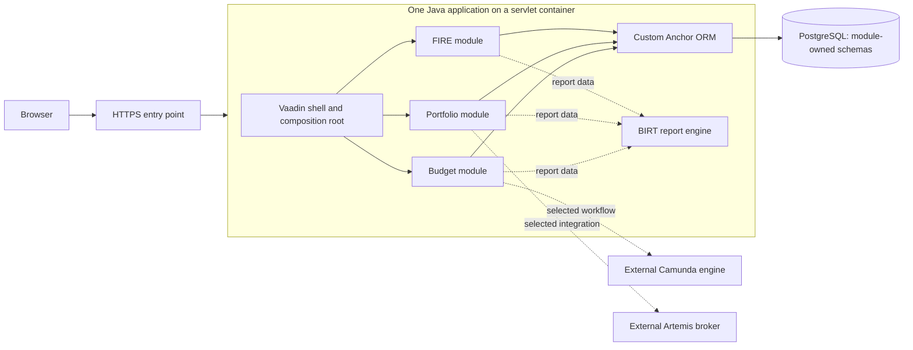

# Finance Lab: Java modular monolith and Anchor persistence

Date: 2026-11-04. Status: agreed direction with proposed implementation details;
repository/backlog setup is recorded in the release plan; application implementation has not started.

The selected direction is Java/Vaadin without Spring, PostgreSQL with Anchor
Modeling, a custom ORM, and a root repository assembling separately maintained
modules. Budget, Portfolio, and FIRE remain independent business capabilities;
Budget is implemented first. The initial history model records changes as they
are made, without backdated corrections or a second temporal dimension.
Monthly Budget edits use an explicit Save button; typing does not persist data.

The first release targets the Russian market with a Russian-language interface
and Russian money/date presentation. Budget uses RUB only, accepts nonnegative
amounts with at most two decimal places, and rejects excess decimal places rather
than rounding. The rewritten application starts from an empty database. There is
no existing-data migration requirement; the legacy implementation may be removed
as part of rewrite bootstrap. V2/V3 import and backward compatibility are outside
the first release, and keeping the old application runnable is not required.

The first release is a private, single-user application hosted on Yandex Cloud
and accessible online through a web browser. Access uses one preconfigured
username/password account, with no public registration.
The application and PostgreSQL run on the same Yandex Compute Cloud VM. Low cost
and operational simplicity take priority for this release; managed PostgreSQL
is deferred to a possible future release.

Those choices are confirmed requirements. The concrete module packaging,
mapping approach, database constraints, and integration boundaries below are
proposed decisions for review. Examples and identifiers are synthetic.

## 1. System boundary

One Java application serves the Vaadin UI and executes business operations.
It uses one application PostgreSQL database, with a schema owned by each business
module. Camunda and Artemis are external runtimes when their features are enabled.
BIRT runs through its Java Report Engine inside the application.



Dashed connections are possible integration boundaries, not committed features
or a required startup dependency for basic Budget use. Business modules call
their own application services directly in Java. A separate REST API or BFF is
not needed for the Vaadin UI; external APIs require a separately selected use case.

Logical independence means a user can use any business capability without first
creating data in another. It does not promise independent deployment, scaling,
or fault isolation: the modules share a process and a release.

The version policy is the latest stable, mutually compatible releases, pinned
in the build; no floating `latest` dependencies or prereleases. This does not
silently substitute an older Java LTS for the latest GA release. Exact pins need
a runnable compatibility check before bootstrap. Vaadin's documented Servlet 6.1
baseline makes Jetty 12.1 a candidate runtime. Proposed starting arrangement:
use Jetty for development and the first packaged application; Tomcat remains
an alternative deployment target, not a second required server. See the
[Vaadin compatibility matrix](https://vaadin.com/docs/latest/compatibility) and
[Jetty compatibility table](https://jetty.org/docs/jetty/12.1/index.html).

### Private online access and Yandex Cloud deployment

The hosting provider, shared application/database VM, online browser access and
single preconfigured account are confirmed. The endpoint is internet-reachable
over HTTPS; application data is available only after authentication. A local demo
without authentication does not satisfy the first-release requirement.

The root application owns a Russian-language login page and servlet-compatible
form authentication. Reuse the container's session/authentication integration,
with a narrow adapter for the configured account and a maintained password-hash
verifier. This does not introduce Spring, an identity-provider service, or a
separate authentication repository. Vaadin documents
[security integration for plain Java](https://vaadin.com/docs/latest/flow/security/advanced-topics/securing-plain-java-app),
and Jetty exposes [authenticator and login-service integration](https://jetty.org/docs/jetty/12.1/programming-guide/security/index.html).
The exact adapter/library combination still needs verification with the pinned
runtime; framework integration is not an implemented login flow.

Provision one stable internal owner ID, username and salted adaptive password
hash through protected deployment configuration. The proposed hash algorithm is
Argon2id through an established library, following
[OWASP password storage guidance](https://cheatsheetseries.owasp.org/cheatsheets/Password_Storage_Cheat_Sheet.html).
No plaintext password or real account value belongs in source, images, fixtures
or logs. Username/password rotation retains the owner ID and existing budgets.
Recovery is an operator action through cloud administration, not a public email
reset workflow. Rotation invalidates active sessions. No registration, user
directory, invitations, social login or account-management UI is in release one.

Use server-side sessions with `Secure`, `HttpOnly` and `SameSite=Lax` cookies;
rotate the session ID on login, enforce explicit expiry, and invalidate it on
logout. Keep Vaadin's request protections enabled, protect login/logout mutations
against CSRF, and throttle failed login attempts. Authentication gates business
views, history, downloads and any data endpoints; hiding navigation is insufficient.
Only the login flow and the static resources it requires are anonymous. Public
status responses, if needed, contain no configuration or financial information.

Map the authenticated principal to the configured owner ID on the server.
Retain owner-scoped queries and the unique `(owner_id, month)` budget key even
with one account. A client-supplied owner ID never selects data. The account may
have several concurrent sessions or tabs, so the save-conflict rules still apply.

Selected first-release placement:

```text
Browser --HTTPS--> reverse proxy --loopback--> Jetty/Vaadin application
                                                   |
                                              PostgreSQL
                                      (local/private connection)
```

Run these on one Yandex Compute Cloud VM with persistent database storage.
Keep Jetty's backend connector and PostgreSQL off the public network; allow web
ingress and restrict administrative access with
[Yandex VPC security groups](https://yandex.cloud/en/docs/vpc/concepts/security-groups).
Only the trusted local proxy supplies forwarded request headers. Reuse the existing
project domain and email; configure DNS and a renewable TLS certificate at
deployment. Root startup/configuration must fail closed if the real account
configuration is absent.

One VM is the selected topology, not a purchased resource or a high-availability
design. Its failure or maintenance interrupts both application and database.
The operator owns updates and PostgreSQL backup/recovery. Managed PostgreSQL is
outside the first release and may be evaluated as a later improvement; no
preparatory migration infrastructure is required now.

### First-release VM and monthly estimate

Use this sizing baseline for deployment planning:

- Russia region (`ru-central1`), Intel Ice Lake (`standard-v3`), regular
  non-preemptible Linux VM, running continuously.
- 2 vCPUs at 20% guaranteed performance and 4 GiB RAM for the reverse proxy,
  Jetty/Vaadin application and PostgreSQL together.
- One 30 GiB network SSD (`network-ssd`) for the OS, application and database;
  bounded log retention and monitoring of free disk space.
- One attached static public IPv4 address; use the existing domain/DNS service.
- Build production artifacts in CI or locally, not on this VM. This estimate
  covers the initial Budget release, without separate Camunda/Artemis services
  or heavy reporting workloads.

The [20% performance level](https://yandex.cloud/ru/docs/compute/concepts/performance-levels)
does not provide two full CPU cores continuously. It is a cost-saving starting
point for intermittent single-user use. Four GiB leaves more headroom for Java,
PostgreSQL and the OS than a 2 GiB VM. Capacity is an engineering estimate, not a
benchmark result: check real memory use, UI latency and backup duration before
launch. Increase resources only if those measurements require it.

Estimate checked on 2026-11-04 against published Russia-region RUB tariffs,
including VAT, for a 30-day month (720 hours), without promotional credits or
commitment discounts:

| Item | Rate and calculation | Monthly RUB |
| --- | --- | ---: |
| VM CPU and RAM | `(2 × 0.52 + 4 × 0.33) × 720` | 1 699,20 |
| 30 GiB network SSD | `30 × 0.0199 × 720` | 429,84 |
| Attached public IPv4 | `0.26352 × 720` | 189,73 |
| 5 GiB retained STANDARD backups | `5 × 0.0033 × 720` | 11,88 |
| **Estimated total** | | **2 330,65** |

Sources: [Compute Cloud tariffs](https://yandex.cloud/ru/docs/compute/pricing),
[VPC tariffs](https://yandex.cloud/ru/docs/vpc/pricing), and
[Object Storage tariffs](https://yandex.cloud/ru/docs/storage/pricing).
The official rendered tariff tables are also available in Yandex's documentation
repository for [compute](https://github.com/yandex-cloud/docs/blob/master/md-docs/compute/pricing.md),
[VPC](https://github.com/yandex-cloud/docs/blob/master/md-docs/vpc/pricing.md), and
[storage](https://github.com/yandex-cloud/docs/blob/master/md-docs/storage/pricing.md).

A 31-day month is approximately 2 408 RUB. Use **2 600 RUB/month** as a planning
allowance, not a spending authorization or billing cap. The estimate assumes
light traffic within available free egress/request allowances; backup storage
is conservatively charged without its free allowance. Five GiB is an assumed
total retained backup volume, not a measured size or enforced cap. Recalculate
if data, history or traffic grows. Keep this conservative allowance with weekly
backups; lower actual storage use saves at most about 12 RUB/month at this size.
Existing domain/email charges are excluded
from incremental hosting cost. No additional paid DNS, load balancer, NAT
gateway, managed database, backup agent or paid software image is included.
Recheck the provisioning quote before purchasing resources.

### First-release backup and recovery plan

Use a private Yandex Object Storage bucket in STANDARD storage, separate from
the application VM. A weekly systemd timer on Sunday at 03:00 `Europe/Moscow` creates a
full application database backup with `pg_dump -Fc`, including all module
schemas and recorded history. Take another backup before database-changing
deployments. PostgreSQL documents [consistent dumps and custom-format restores](https://www.postgresql.org/docs/current/app-pgdump.html);
copying a live database directory is not the backup procedure.

Encrypt archives before upload using [age](https://github.com/FiloSottile/age).
Keep the encryption recipient public key on the VM and the recovery private key
in an independent protected store off the VM. Upload through a restricted
service account to unique timestamped object names. Keep the bucket private,
and let a [lifecycle rule](https://yandex.cloud/en/docs/storage/concepts/lifecycles)
expire backups after 28 days. This retains approximately four weekly recovery
points, plus any pre-deployment backups, with no additional retention tiers.

Check dump/encryption/upload completion and uploaded integrity before reporting
success; remove temporary local archives after successful upload. Send a
success or failure report after each backup to the existing project email through
its configured mail provider. Missing weekly reports require investigation; a failed VM cannot
send its own failure notification. Verify mail delivery during deployment.

Keep recovery instructions, exact application/runtime versions and database role
definitions reproducible. Preserve required private configuration, credentials
and the stable owner ID in a protected off-VM recovery copy, updated when changed.
A database dump alone does not preserve PostgreSQL roles or VM configuration.

- **Recovery point target:** approximately seven days of possible lost changes
  with successful weekly backups, plus backup completion time. There is no
  point-in-time recovery/WAL archive in release one.
- **Recovery time target:** four hours from the operator starting recovery;
  this remains unproven until a timed exercise succeeds.
- **Restore verification:** before launch, recover onto a clean environment
  from downloaded, decrypted backups and the recovery configuration; verify
  login, current Budget values and recorded history. Repeat a database restore
  monthly on an isolated local PostgreSQL instance to avoid a standby VM bill.

The plan handles loss of the VM/disk but provides no automatic failover.
No resources, backup jobs, email messages or deployment changes are created by
this architecture decision.

### Russian presentation and the first Budget value contract

The market, language, RUB-only scope, two-decimal input limit, technical amount
range and fresh start are confirmed. The exact parsing rules and display
time-zone default below remain proposed implementation details of that direction.

| Concern | First-release rule |
| --- | --- |
| Language | Russian labels, navigation, validation messages, empty states and user-facing reports; explicit `ru-RU` locale |
| Money display | `1 234,56 ₽`: comma decimal separator, nonbreaking-space grouping, currency symbol after the amount, always two decimal digits |
| Date display/input | `04.11.2026`, with a four-digit year and strict calendar validation |
| Budget month | `ноябрь 2026` in the UI; a `YearMonth` value internally, not a timestamp |
| Calendar | Russian month/day names and controls, Monday as the first day of the week |
| Time display | 24-hour time; any history timestamp identifies its display time zone |

Use the [Unicode Russian locale data](https://github.com/unicode-org/cldr/blob/main/common/main/ru.xml)
as the formatting reference. Configure Vaadin component translations explicitly;
setting a locale alone does not supply all application labels. Its
[Date Picker format API](https://vaadin.com/docs/latest/components/date-picker/date-formats)
supports explicit date formatting. Strict Java date parsing uses `dd.MM.uuuu`;
invalid dates such as `31.02.2026` must not roll into another month.

Locale belongs to UI/report adapters. Domain objects, ORM mappings, keys and
stored dates remain independent of presentation. Java `LocalDate` values do not
gain a time zone; Anchor history uses instants stored as PostgreSQL `timestamptz`
with UTC application/database session configuration. The proposed initial demo
display zone is explicitly configured `Europe/Moscow`, shown to the user; it
does not follow from `ru-RU` or represent every Russian user's zone. Changing
display zone must not change a saved budget's month or historical instant.

Money input is text parsed directly into `BigDecimal`, without a `double` or a
browser numeric conversion. The input control shows the currency separately.
Proposed input rules:

- Accept ASCII digits with a required integer part and an optional comma followed
  by one or two digits. Ungrouped integers may have leading zeros; they are
  normalized in the new model rather than preserved as an original spelling.
- Optionally group the integer part in threes. Grouped numbers start with one to
  three digits and no leading zero. Accept space (`U+0020`), nonbreaking space
  (`U+00A0`) and narrow nonbreaking space (`U+202F`) as separators; verify grouping
  before removing them. Trim those same characters at the ends only.
- Empty input after that trimming means `UNSET`; `0`, `0,0` and `0,00` mean `SET`
  with numeric zero. Unset values contribute zero to totals but remain unset.
- Reject minus/plus signs, decimal dots, exponents, currency symbols in the value,
  mixed decimal separators, invalid grouping, tabs/newlines and trailing text.
  A partial edit such as `1,` remains editable but cannot be saved.
- Reject more than two fractional digits, including `1,000`. Validate the complete
  text, then convert exactly and normalize to scale two; never truncate or round.
  All non-UI entry points enforce the same domain precision and range rules.

| Input | Result |
| --- | --- |
| Empty field | Unset amount |
| `0` | Numeric `0.00`, displayed as `0,00 ₽` |
| `1234` or `1 234` | Numeric `1234.00` |
| `1234,5` or `1 234,50` | Numeric `1234.50` |
| `12 34`, `1,234`, `1.23`, `1e3`, `-1`, `,50` | Validation error; nothing saved |

**Accepted decision (2026-11-04):** store each BudgetLine amount as
`NUMERIC(19,2)`, with the technical range `0.00` through
`99999999999999999.99` RUB, inclusive, and no smaller business maximum.
The same range applies to income, spending and investment allocation.
Validate it before writing and constrain stored values to that range.
Reject excess decimal places before insertion; never round an entered amount.
PostgreSQL can round on assignment to a scale-constrained numeric column, so
database coercion must never substitute for application/ORM precision validation.
[PostgreSQL numeric behavior](https://www.postgresql.org/docs/current/datatype-numeric.html)
documents this distinction.

Compute totals with exact decimal addition/subtraction. Remaining may be negative
even though entered amounts are nonnegative. Derived totals are not restricted
to one input column's magnitude and are not persisted as line amounts. The first
Budget operations need no rounding mode because they do not divide amounts.
Portfolio prices, quantities, exchange rates and FIRE calculations will get their
own precision contracts; the Budget input limit is not a universal ORM rule.

Every new Budget records currency `RUB` explicitly, with no currency selector or
FX conversion. Any future machine-readable contract uses exact decimal strings
such as `"1234.50"`, explicit currency, and ISO dates/months. Localized UI text is
not the storage or backup representation. The first release needs no language
switcher or separate internationalization service.

### Configurable spending categories

The first rewritten release starts with ten default spending categories and
supports adding and editing categories. Removal archives the category: its
identity, saved monthly amounts and history remain intact. Income and investment
allocation remain separate from spending. This replaces the earlier proposal
for fifteen fixed categories.

Product sources are frontend [#9](https://github.com/finance-lab-project/frontend/issues/9)
(defaults and domain), [#10](https://github.com/finance-lab-project/frontend/issues/10)
(catalog and monthly amounts), and [#11](https://github.com/finance-lab-project/frontend/issues/11)
(Settings category management). Issues #9 and #10 were marked completed when
inspected on 2026-11-04; #11 was open. These are product requirements to adapt to
Java/PostgreSQL, not instructions to recreate the React/localStorage architecture
or import every feature from the older roadmap.

Use the exact starter order from #9 with Russian display labels:

1. Жильё и коммунальные услуги
2. Продукты
3. Рестораны и доставка еды
4. Транспорт
5. Здоровье и уход за собой
6. Одежда и товары для дома
7. Подписки и связь
8. Образование и хобби
9. Кредиты, страхование и налоги
10. Прочие и нерегулярные расходы

The proposed Settings → Categories screen supports add, rename, reorder and
archive. Use one owner-scoped catalog shared across months, following #11.
Seed the ten defaults once; startup must not reset edited labels, order or
archived state. Category IDs are stable, never derived from labels or positions
and never reused. Defaults are editable category records, not a permanent limit.
Retain the reviewed [V3 catalog label policy](https://github.com/finance-lab-project/frontend/blob/main/docs/budget-v3.md):
trimmed nonempty labels; duplicate labels may exist but identities must differ.

Proposed cross-month behavior:

- Rename/reorder changes the current editor's presentation across months without
  changing amounts. Previously recorded Budget revisions retain the category
  labels/order from their referenced catalog revision.
- Adding a category makes it available with an unset amount in current editors
  and new budgets. Persist a missing monthly line on the next explicit save;
  catalog edits alone do not rewrite every month's data or create budget revisions.
- Archiving excludes a category from new budgets and from adding new monthly
  lines. Previously saved lines remain visible, editable and included in totals,
  including zero/unset lines; archived status is shown. History stays readable.
- No hard deletion, merging or reassignment of saved category amounts is in the
  first release. Missing/corrupt references are errors, never an excuse to omit
  an amount from totals. Restoring archived categories is a separate scope choice.

## 2. Repositories and artifacts

The following public repositories were created in `finance-lab-project` on
2026-11-04. Portfolio and FIRE initially contain planning documentation only.

| Repository | Owns | Output / timing |
| --- | --- | --- |
| [app](https://github.com/finance-lab-project/app) | Canonical architecture and release plan, application assembly, Vaadin navigation shell, configuration, authenticated session integration, explicit service wiring, resource lifecycle, end-to-end checks | One WAR application; first increment |
| [orm](https://github.com/finance-lab-project/orm) | PostgreSQL mapping engine, JDBC sessions, transaction execution, Anchor metadata and SQL generation | Java library; first increment |
| [budget](https://github.com/finance-lab-project/budget) | Monthly planning, category catalog/lifecycle, validation, totals, recorded history, its UI, persistence adapters, migrations and tests | Java library; first business module |
| [portfolio](https://github.com/finance-lab-project/portfolio) | Holdings, transactions and portfolio calculations; its UI, persistence and migrations | Java library; boundary designed now, implementation later |
| [fire](https://github.com/finance-lab-project/fire) | Financial-independence goals, assumptions and projections; its UI, persistence and migrations | Java library; boundary designed now, implementation later |

Use Maven, consistent with the existing Java build. The root repository owns a
small, separately publishable build-parent POM and the application assembly.
The parent contains build conventions, not application-module dependencies.
The application pins module artifact versions in dependency management. Each
business module and the ORM build from their own repository against published
parent/library artifacts; none depends on the application WAR.

Release assembly consumes immutable library versions and records their source
revisions. For a change spanning repositories, build and verify the changed
library, then verify the root against that exact artifact. Local development
can install a library into the local Maven repository. Release builds must not
depend on an uncommitted sibling checkout or mutable snapshot artifact.

GitHub is the selected repository, issue and Project home. Each repository has
its own private delivery board; public repository visibility does not make the
deployed application public. GitLab remains a requested stack-alignment topic:
choose the CI/artifact-registry arrangement explicitly during build planning,
without assuming or performing a hosting migration. Track design and delivery
tasks directly; separate learning issues are not part of the new backlog.

## 3. Internal structure and dependency rules

Each business module is a vertical slice. Its conceptual package structure is:

```text
api/                  public commands, query interfaces and result DTOs
domain/               business values, entities and calculations
application/          use cases, authorization, persistence/transaction ports
adapter/ui/           Vaadin views calling application services
adapter/persistence/  ORM mappings and repository implementations
resources/db/         module-owned versioned SQL migrations
```

Report templates, BPMN definitions and integration adapters belong to the module
whose use case needs them. They are added with that feature, not as empty modules.

- `domain` uses Java types and business code, not Vaadin, JDBC, Camunda or BIRT.
- `api` exposes business DTOs, not tables, ORM sessions or mutable persistence objects.
- `application` owns validation, access checks and the transaction boundary; its
  persistence ports are implemented by `adapter/persistence` using the ORM.
- ORM session types stay inside persistence adapters. UI code never opens a
  connection or writes through a generic entity manager.
- The root constructs concrete services explicitly and integrates their views
  with Vaadin. No new DI container, runtime plugin system, or shared business
  orchestrator is required.
- Modules do not import another module's internals or read its tables. A selected
  cross-module feature uses the provider's public Java query API and DTOs.
- Budget has no dependency on Portfolio or FIRE. Portfolio has no dependency on
  Budget. FIRE accepts its own inputs; a future Portfolio-to-FIRE convenience
  import uses an explicit adapter and does not make Portfolio data mandatory.
- Schema ownership is a code/review boundary within a shared process, not a
  security sandbox. Foreign keys stay within a business module's schema.

Authentication follows the single-account design above and is integrated at the
root. Business services enforce ownership and authorization, using identity
supplied by that trusted integration, never by a browser-supplied owner field.
A fixed test identity is permitted only in an explicitly local test/demo profile;
it cannot be enabled in the online release.

## 4. Anchor Modeling profile

Use the four established constructs: anchors identify things; attributes store
their properties; ties connect anchors; knots hold stable value catalogs.
Each attribute has its own table. The ORM assembles useful Java objects from
these structures. This follows the
[Anchor Modeling constructs](https://github.com/Roenbaeck/anchor/blob/master/docs/ANCHOR.md);
the project's bounded temporal and operational choices are specified below.

The first profile uses a single `changed_at` time coordinate. Changes become
effective when the application records them. Historical business dates such as
the budget month remain ordinary data. Do not accept caller-supplied backdating,
future-effective writes, bitemporal assertions, or retroactive history edits.

This is a deliberate restriction of a single-time model: it cannot separately
answer what was effective in the business and what was known at another time.
Adding that capability later requires a schema/API migration and a separate
decision, not simply another timestamp column.

### Budget model

**Accepted decision (2026-11-04):** use one shared `BudgetLine` model within
the Budget module for income, spending and investment allocation. Its immutable
kind is `INCOME`, `SPENDING` or `INVESTMENT`. All three kinds use the same
line anchor, amount history and `SET` / `UNSET` state mechanism.

Each saved monthly Budget has exactly one income line, exactly one investment
line and one spending line per category represented in that month. A spending
line references exactly one category owned by the Budget owner; income and
investment lines have no category. Income and investment remain separate fields
in the UI and separate terms in totals, represented by distinct instances of
the shared model.

This keeps amount persistence and history uniform across the three kinds.
Separate income/spending/investment entity models and parallel sets of Anchor
tables are not selected. Concrete DDL and constraint enforcement remain design
work in [budget #1](https://github.com/finance-lab-project/budget/issues/1).

Categories have their own identity and editable properties, so model them as
anchors. Only fixed value sets such as line kind and lifecycle status are knots.
The ten defaults are initial category data, not ten fixed columns.

| Construct | Proposed representation |
| --- | --- |
| Budget anchor | `budget.budget(budget_id)`; surrogate UUID identity |
| Budget static attributes | Separate owner, month and currency tables keyed by `budget_id` |
| Category anchor | `budget.category(category_id)`; stable UUID identity |
| Category static attribute | Owner, shared by the category catalog and its monthly budgets |
| Category historized attributes | Separate name, display-position and `ACTIVE` / `ARCHIVED` status tables |
| Shared BudgetLine anchor | `budget.budget_line(line_id)`; one independently historized monthly amount for any line kind |
| Static tie | `budget.line_in_budget(line_id, budget_id)`; each line belongs to one budget |
| Static knotted attribute | Line kind: `INCOME`, `SPENDING` or `INVESTMENT` |
| Static category tie | `budget.line_category(line_id, category_id)`; exactly one category for a spending line, none for other kinds |
| Historized attribute | `budget.line_amount(line_id, changed_at, amount)` |
| Historized knotted attribute | `budget.line_amount_state(line_id, changed_at, state)` with `SET` / `UNSET` |
| Knots | Line kind, currency, amount state and category status in the Budget schema |

Anchors hold identity only. Static attributes and ties are immutable through the
initial application API. Changes to amounts append history; they do not overwrite
past values. Renaming, reordering and archiving append category attributes;
they do not replace a line's category tie. Historized ties are a supported future
profile extension, not needed for this model. Domain modules own both their
model and its DDL.

New monetary values follow the Russian Budget contract above: `BigDecimal`,
explicit `RUB`, at most two decimal places at input, and no silent rounding.
The accepted storage is `NUMERIC(19,2)` with the technical amount range above
and no smaller business maximum. Numeric zero and an unset amount are distinct.
Totals are calculated by Budget and are not stored as additional mutable facts.
The ORM supplies exact codecs; Budget owns these value constraints.

### Clearing an amount and reading history

Line creation records exactly one initial state: `SET` plus the entered amount,
or `UNSET` without an amount. Do not insert an intermediate `UNSET` and then `SET`
at the same change time. Historical reads before the first state omit the
not-yet-created line. Changing a value appends `SET` plus the new amount at the
same change time. Clearing it appends `UNSET`, retaining the earlier amount as
history. Setting it again records the amount and `SET` together, including when
the numeric value equals an older value from before the clear.

For a read at time T, select the latest state at or before T. If it is `UNSET`,
return an unset amount; if it is `SET`, require the amount recorded at that state's
exact change time. A missing companion amount is an integrity error, not permission
to reuse an older amount or substitute zero. An absent initial fact must not be
confused with clearing a previously known value. This
explicit state convention is our application choice, informed by Anchor's
[absence and historization examples](https://www.anchormodeling.com/tutorials/).

For example: set `100.00` at T1, clear at T2, set `150.00` at T3. Reads in
`[T1,T2)`, `[T2,T3)`, and `[T3,...)` return `100.00`, unset, and `150.00`.

### Constraints and operational tables

Use primary/foreign keys for anchor, attribute, knot and tie references. History
tables are unique on `(anchor_id, changed_at)`, with indexes for latest/as-of
reads. The line-to-budget tie permits only one budget per line.

Some invariants span several Anchor tables. Enforce them through explicit
operational tables beside the model:

- A budget key/guard table enforces `UNIQUE(owner_id, month)` and stores the
  current aggregate version and last change time.
- A line-key table identifies each line once. It enforces uniqueness of
  `(budget_id, category_id)` for spending and `(budget_id, kind)` for income and
  investments. Spending requires a category; other kinds forbid one. Categories
  must belong to the budget owner.
- Composite foreign keys connect duplicated key components to the corresponding
  static attributes/tie, whose referenced column pairs have unique constraints.
  This prevents the operational keys from contradicting the Anchor facts.
- A category catalog guard and revision table record the owner-scoped catalog's
  version and change time. One catalog command, including a reorder of several
  categories, appends its changed facts and one revision atomically. Initial
  category facts include `ACTIVE`; reads before creation omit that category.
- A Budget revision records `(budget_id, version, changed_at, catalog_version)`.
  Reconstruct amounts at the Budget revision's time and category labels/order
  at its referenced catalog revision's time. Later catalog edits cannot relabel
  a previously saved revision. The two aggregates have separate recording clocks;
  an explicit version reference avoids depending on their timestamp ordering.

These tables are deliberately conventional transaction/identity support. They
do not replace the Anchor facts or become a generic entity-attribute-value store.
Creation writes the anchors, static facts, keys and initial revision atomically.
Versions start at one; zero is the application's marker for an unsaved budget,
not a stored revision. Guard updates and revision inserts use the same transaction
as their facts, so rollback does not advance a committed aggregate version.

## 5. Custom ORM contract

Build a small Anchor-aware data mapper for PostgreSQL. Domain repositories define
aggregates; the ORM maps the underlying structures and executes persistence work.

Separate Java mapping definitions are agreed. Each business module keeps them in
`adapter/persistence/mapping/`; domain classes contain no ORM annotations or
imports. The module supplies its mappings explicitly during root assembly, without
classpath scanning. The definitions describe storage; they do not execute business
commands or own schema migrations. Concrete Java API signatures remain to be
verified during implementation.

| Component in the ORM library | Responsibility |
| --- | --- |
| Mapping metadata | Explicit Java descriptors for anchors, typed attributes, knots, ties, keys and historization; mappings are supplied by the owning module |
| SQL generation | Produce parameterized PostgreSQL reads/inserts from those descriptors; table/column identifiers come only from trusted mappings |
| Value codecs | Explicit JDBC conversion for UUIDs, strings, integers, dates, timestamps and decimals; preserve precision and reject unsupported conversions |
| Session | Own statement/result-set resources within one borrowed JDBC connection; never shared across UI sessions or background jobs |
| Transactions | Run an explicit unit of work on one connection; commit before returning success, roll back failures and release resources; no per-attribute commits |
| Projection mapping | Materialize explicit current/as-of results; combine narrow-table results into module-defined DTOs without hidden lazy queries |

Mapping metadata is authoritative for runtime mapping; reviewed SQL migrations
are authoritative for deployed schema. An integration check verifies they agree.
Do not generate or alter production schema at application startup. Use an
established migration runner, selected during bootstrap, rather than writing a
second custom infrastructure tool. Root deployment orders the selected modules'
migrations and checks compatibility before starting the application.

The initial ORM supports static attributes, knotted attributes, static ties,
historized scalar/knotted attributes, parameterized identity lookup, and explicit
current/as-of projections. It generates reusable SQL from metadata; it is more
than a collection of handwritten per-entity JDBC helpers.

Explicit write operations insert anchors/static facts or append historized facts
inside that unit of work. They do not independently choose business revisions,
timestamps or change detection rules. The Budget persistence adapter supplies
the complete write set and recording coordinate. The ORM must not discard equal
facts automatically: a repeated `SET` state can be required to accompany a new
amount, or an amount may recur after a clear. Guard/revision SQL and generated
Anchor writes share the same connection and transaction. A transaction-scoped
session cannot escape its callback, nest an independent commit, or be reused after
completion; the transaction runner owns connection cleanup, including discarding
an unusable connection after a failure.

It does not implement JPA, dirty checking, lazy proxies, automatic cascades,
runtime schema discovery, a universal query language, multi-database dialects,
or a global cache. Use explicit mapping definitions rather than starting with
annotation scanning or a code generator. Ordinary JDBC drivers and a maintained
connection pool remain dependencies; custom ORM does not mean custom networking.

Complex queries may use reviewed SQL inside a module's persistence adapter,
with the same parameter binding, identity scope and transaction rules. This
escape hatch must not expose raw SQL to the UI or bypass another module's API.

### Worked example: Category mapping

The following is a proposed mapping/schema sketch, not implemented Java or an
executed migration. `CategoryMapping` belongs to the Budget module and describes:

| Definition | Proposed PostgreSQL table/columns | Java value |
| --- | --- | --- |
| Anchor | `budget.category(category_id)` | UUID identity |
| Static owner attribute | `budget.category_owner(category_id, owner_id)` | UUID |
| Historized name | `budget.category_name(category_id, changed_at, name)` | String |
| Historized display position | `budget.category_position(category_id, changed_at, position)` | Integer |
| Historized status | `budget.category_status_history(category_id, changed_at, status_code)` | Explicit mapping from a domain status to a knot code |
| Status knot | `budget.category_status(status_code)` | `ACTIVE`, `ARCHIVED` |

Each attribute references the category anchor. Static owner has one row per
category; each history table uses `(category_id, changed_at)` as its key. Status
codes reference the knot. The spending-line-to-category tie belongs to the Budget
line mapping, so a category does not contain or cascade-save its monthly lines.
Reviewed migrations create these tables/constraints; descriptors identify their
columns, codecs, relationships and history coordinate for generated runtime SQL.

The first ORM API needs these explicit operation groups; names here describe
capabilities, not finalized method signatures:

| Operation group | Contract |
| --- | --- |
| Transaction / read snapshot | Supply a scoped session on one connection; write commit/rollback and consistent read assembly follow section 6 |
| Insert anchor/static fact/tie | Write identities and immutable relationships from trusted mappings and bound values |
| Append historized fact | Insert the supplied identity, value and recording coordinate; never overwrite an earlier fact or silently suppress a repeated value |
| Read current / at coordinate | Project requested mapped attributes at the latest state or at/before the supplied coordinate; return absence explicitly |

There is no generic `save(category)` that guesses changes by inspecting a mutable
object. A category command is implemented by the Budget application service and
its persistence adapter:

1. Validate the requested name/order/status and authenticated ownership.
2. In one ORM transaction, lock/check the catalog guard as specified in section 6,
   load the relevant current state and detect a no-op.
3. Otherwise choose the catalog's recording coordinate, append the changed
   attribute facts through the mapping, advance the guard and insert the catalog
   revision using the same session. Return success only after commit.

For example, a synthetic category is created at catalog revision 1 with name
`Транспорт`, position 4 and status `ACTIVE`. Revision 2 renames it to
`Транспорт и такси`: only a name fact is appended. Revision 3 archives it: only
a status fact is appended. Its identity and spending-line ties stay unchanged.

The Budget repository resolves a requested catalog revision to its recording
coordinate, checks ownership and asks the ORM for the mapped projection in one
consistent snapshot. A read at revision 1 returns `Транспорт / ACTIVE`; revision
2 returns `Транспорт и такси / ACTIVE`; revision 3 returns
`Транспорт и такси / ARCHIVED`. Before creation, the category is absent. Required
attribute gaps after creation are integrity errors, not empty labels/defaults.
A Budget revision referencing catalog revision 1 still shows the original name.

The same mapping metadata supports current and historical reads. The ORM knows
how to select facts; Budget knows which catalog revision to use, what archiving
means, and whether the result belongs in a new or existing monthly editor.

## 6. Transactions, concurrent saves and reads

### Save command and revision boundary

Explicit Save and the save/history behavior below are agreed for the first release.
The SQL protocol remains an implementation design to verify. Edits remain a UI
draft until Save; navigating away from a
dirty month requires an explicit save/discard/cancel choice. No database transaction
or row lock remains open while the user edits. Unsaved drafts are not durable
and are not covered by database backups.

The Budget application service receives the month, expected Budget version,
expected catalog version and a complete set of typed values for income, spending
and investments. Identity comes from the authenticated server context. Each value
is explicitly `Unset` or `Set(BigDecimal)`; omitted values do not mean clear or
zero. Spending is keyed by category ID. Validate the exact permitted set: current
active categories plus archived categories already represented in that budget.
Reject unknown, missing, duplicate or foreign-owner IDs. For creation, expected
Budget version zero means "create only if absent", never an unconditional upsert.

One accepted state change creates one Budget revision, even when many amounts
change. Creation and addition of monthly lines count as changes. Once versions
are validated, saving identical normalized amounts and the same line membership
returns `Unchanged` without new history or a version increment. A catalog-only
rename/reorder/archive does not by itself create a Budget revision. Catalog
commands have their own expected version and atomic revision; no-op commands
likewise do not append history. Budget owns these equality and boundary rules.

| Outcome | Observable contract |
| --- | --- |
| `Saved` | Commit is confirmed; return the saved Budget version, recording time and referenced catalog version |
| `Unchanged` | The command is current and valid, but no persisted Budget state changed; retain the existing revision |
| `Invalid` | Return field/domain errors and preserve the draft; no partial writes |
| `Conflict` | Budget or catalog version is stale, including a competing first creation; preserve the draft and require explicit reconciliation/reload |
| `Failed` | Failure is known to precede commit or the transaction is known to have aborted; preserve the draft |
| `OutcomeUnknown` | Commit may have happened but confirmation was lost; do not report either success or "nothing was saved" |

Application outcomes are separate from raw JDBC exceptions. Do not expose SQL or
credentials through UI errors, silently overwrite newer data, or automatically
merge edits from different tabs. Historical facts are append-only; operational
guard rows may be updated. This is revision history, not an event-sourced command log.

### Atomic write protocol

Use a short `READ COMMITTED` write transaction with explicit row locks:

1. Validate ownership/shape/precision, lock the owner's catalog guard with
   `FOR SHARE`, and verify the expected catalog version and permitted categories.
2. Lock the existing Budget guard with `FOR UPDATE` and verify its expected
   version, or attempt first creation under `UNIQUE(owner_id, month)`. A competing
   insert loses with a conflict; roll back the whole attempted save.
3. Compare the normalized draft with the locked current state. For a no-op,
   release the transaction without changing guards, facts or revisions.
4. Otherwise select one recording time, create required identities/static facts,
   and append the changed amount/state facts. For new lines, write only the final
   initial state. Unchanged lines do not get additional facts.
5. Advance the Budget guard and insert one revision referencing the checked
   catalog version. Commit all writes together, then return `Saved`.

Category commands use `FOR UPDATE` on the catalog guard, check its version and
append catalog facts plus one revision atomically; they do not rewrite monthly
amounts. Always acquire the catalog guard before the Budget guard. Hold locks
until commit/rollback. This prevents a catalog edit between a Budget save's
validation and commit. Use `FOR SHARE`, not the weaker `FOR KEY SHARE`, because
catalog changes need not change a key.
[PostgreSQL row-lock behavior](https://www.postgresql.org/docs/current/explicit-locking.html#LOCKING-ROWS)
supports this protocol; the choice of guard and version belongs to Budget.

After locking the aggregate guard, compute the recording coordinate once as
`max(clock_timestamp(), previous_changed_at + 1 microsecond)` at `timestamptz(6)`
precision; use the database clock alone for its first revision. Reuse that value
for all facts/revision metadata in the command. PostgreSQL's `CURRENT_TIMESTAMP`
represents transaction start, whereas
[`clock_timestamp()`](https://www.postgresql.org/docs/current/functions-datetime.html#FUNCTIONS-DATETIME-CURRENT)
samples the current clock. The monotonic adjustment handles equal/backward clock
readings. Versions order revisions within one aggregate; timestamps are recording
coordinates, not exact commit times or a global ordering across aggregates.

### Current state and recorded history

The application exposes separate current-editor, revision-list and revision-detail
queries, all owner-scoped. Current-editor reads use the current catalog and current
amounts; a missing budget returns an unsaved draft at version zero, not a database
write. History lists committed revisions only, ordered by version. Revision detail
reconstructs monthly facts at that revision and the catalog at its pinned catalog
revision, including original labels/order and line membership. Do not add today's
new categories to old revision details or hide lines because they are archived now.
An unknown revision returns not found, never the latest state. History is read-only;
restoring an old revision, backdating and editing/deleting history are outside v1.

The ORM supplies current/as-of projections, not a Budget-specific history API.
For an amount, no state before T means the line did not exist; `UNSET` means a
known empty value, and `SET(0.00)` means numeric zero. Budget enforces paired
state/value integrity and recalculates totals from the selected revision's values.

Current and historical projections use one consistent database snapshot: one SQL
statement, or a read-only `REPEATABLE READ` transaction for multi-query assembly.
The ORM must not open a new connection for each part. PostgreSQL's default
[`READ COMMITTED`](https://www.postgresql.org/docs/current/transaction-iso.html)
can see different committed states between queries. Snapshot reads do not require
holding the writer's guard locks while presenting the result to the user.

### Failures and retries

The agreed v1 contract has no automatic write retries and no operation-ID receipt
table. Roll back known pre-commit failures and close resources. If connection loss
during commit leaves the outcome unknown, preserve the draft, show an unconfirmed
save state and re-read the budget/history before another user-directed save. A
matching value on reload shows current stored state, not proof of which request
committed. Do not advertise exactly-once saves or repeat an uncertain command
automatically. Apply the same outcome handling to category commands.
Once commit is confirmed, a subsequent cleanup failure must not turn the saved
operation into `Failed` or trigger a duplicate write; handle cleanup separately.

If automatic retries are selected later, first add a durable operation ID,
request identity and saved result in the same transaction; replay matching requests
and reject different contents using the same ID. That is a Budget command contract,
not automatic ORM retry behavior. Existing T2 rules remain review input only.

Keep database transactions short. Do not render a report, await a human task or
call Camunda/Artemis inside a database transaction. No distributed transaction
manager is part of the initial design.

## 7. Reporting, workflows, messaging and cryptography

| Capability | Boundary and ownership |
| --- | --- |
| BIRT | A module owns report templates and authorized query projections. Pass a consistent data snapshot to the Report Engine and render after releasing the DB transaction. Templates do not get unrestricted cross-schema credentials. |
| Camunda | A module owns its BPMN process and worker adapter. Root owns client lifecycle. Workers invoke the same authorized business services as other entry points. Process state stays in Camunda; business facts stay in the module. |
| Artemis | A module owns message meaning, schema and producer/consumer adapters. Root owns broker configuration and connection lifecycle. Ordinary in-process calls do not become broker round trips. |
| Cryptography | A selected signing/verification use case owns its contract. Root supplies a maintained public provider and key configuration. Use synthetic documents and test keys; do not design custom cryptographic algorithms. |
| AI-assisted development | Build, tests and review evidence remain part of delivery. This does not add an AI feature to the application. |

Camunda 8 is an external engine, accessed with its Java client without a Spring
application dependency. See [engine boundaries](https://docs.camunda.io/docs/guides/migrating-from-camunda-7/conceptual-differences/)
and the [Java client](https://docs.camunda.io/docs/apis-tools/java-client/getting-started/).
Its current self-managed production distribution requires a production license;
local development/testing and a deployed product are different deployment plans.
Keep workflow capability optional until its actual use case and deployment cost
are selected. No alternate engine is silently substituted.
[Camunda licensing](https://docs.camunda.io/docs/reference/licenses/)

When an integration must reliably follow a committed business change, persist
an outbox record with that change, dispatch after commit, and deduplicate the
consumer's database effects by operation/message identity in its transaction.
Only introduce these tables with that integration. Assume redelivery; broker
duplicate detection alone is not a guarantee of exactly-once business effects.
Artemis supports [redelivery and dead-letter handling](https://artemis.apache.org/components/artemis/documentation/latest/undelivered-messages)
and [bounded duplicate detection](https://artemis.apache.org/components/artemis/documentation/latest/duplicate-detection.html).

## 8. Clean start and architectural alternatives

The rewrite starts from zero with no existing data to migrate. Legacy application
code and implementation-specific tests, fixtures and tooling may be removed during
bootstrap; there is no requirement to maintain the old runtime or its V2/V3 backup
formats. Keep the agreed product requirements, architecture decisions and Git
history. Reuse old examples only when they help verify the new requirements.

The first SQL migration creates the new schema in an empty database, followed by
initialization of the ten-category catalog. No legacy importer, storage conversion
or compatibility layer is planned. Versioned migrations still manage subsequent
changes to the new schema. Weekly off-VM backup and verified recovery remain
required for data created in the new application.

The [T2 API contract](https://github.com/anton415/finance-lab/blob/main/docs/t2/api-contract.md) supplies useful validation, conflict
and retry scenarios. It is not automatically the internal Vaadin service API.
The [earlier exact-money ADR](https://github.com/anton415/finance-lab/blob/main/docs/architecture/decisions/0022-exact-decimal-money-currency-contract.md)
is useful for value semantics; its Go and database-per-service deployment choices
do not apply to this proposal.

The published [ADR-031](https://github.com/finance-lab-project/platform/blob/main/docs/architecture/decisions/0031-java-spring-budget-incremental-releases.md)
and older [roadmap](https://github.com/finance-lab-project/platform/blob/main/docs/engineering/current-roadmap.md)
describe the previous Spring/React direction. The architecture and release plan
in `finance-lab-project/app` supersede that product direction. Preserve historical
decision records; their old delivery sequence is not the current execution plan.

Compared with ordinary relational tables and a mature ORM, Anchor Modeling plus
a custom mapper increases joins, mapping code and the number of invariants we
must test. It is selected here because explicit temporal persistence and ORM
design are project objectives. Do not assume it is faster: inspect SQL and
measure representative reads before making a performance claim.

Compared with one source repository, separate module repositories add artifact
versioning and coordinated-change work. They are selected to exercise modular
delivery. A single deployed application keeps ordinary business calls and local
transactions straightforward while retaining module ownership.

## 9. First implementation boundary and required evidence

The first proposed slice contains only the root application, ORM and Budget:
initialize the ten-category catalog, edit one synthetic monthly budget in Vaadin,
save it atomically, reload it, and read its prior recorded revisions. The first
release also includes category management and archive behavior described above;
a demonstration with an immutable catalog does not complete that scope.
Portfolio and FIRE get no placeholder code.
Reporting, workflows, messaging and cryptography do not enter this slice unless
its acceptance criteria explicitly require them.

The first online release additionally requires the single-account login/session
flow, HTTPS on Yandex Cloud, protected database connectivity, and verified
backup/recovery. A local Budget demonstration is an implementation milestone,
not the complete online release.

The market, RUB/two-decimal policy, technical amount range, fresh start,
single-account access, cloud provider and shared application/database VM are
selected; the sizing, cost and backup baseline above are defined for planning.
Before coding, review the proposed detailed parser/time-zone and authentication
integration rules, pin the
compatible build/runtime dependencies, and freeze the selected implementation
brief. Before deployment, verify capacity, the current resource quote, existing
domain/email configuration and a successful restore, and obtain spending/release
authorization.
Legacy code removal is allowed as part of the planned rewrite bootstrap. The
current task includes publishing the architecture, creating the module repositories
and reconciling issues/boards. Application implementation, release, resource
provisioning, deployment and spending are separate steps.

Evidence required when the slice is implemented:

1. Domain tests for planning totals, validation, unset versus zero and month scope.
   Include Russian input/grouping, precision and range boundaries, negative
   derived remaining, strict date parsing and display-zone independence.
   Cover ten defaults seeded once, stable IDs, label rules, ordering, and
   preservation of saved amounts/totals when renaming or archiving categories.
2. Real PostgreSQL tests for generated SQL, exact decimal round trips, key
   constraints, rollback of a partial save, and concurrent creation/update.
   Verify one revision for a multi-field change, none for a no-op, and rollback
   of both facts and guard versions after an injected write failure.
3. History tests for set/clear/set, equal clock readings, consistent multi-query
   snapshots, and reads before creation and between revisions.
   Include category changes, Budget revisions pinned to catalog revisions,
   addition of lines, and archive behavior across existing and new months.
   Cover a populated line on first save, unset versus zero, clear then re-enter
   the same amount, and rejection of a `SET` state missing its companion amount.
4. Unknown-commit handling without automatic retries, and connection/statement
   cleanup on success/failure. Add operation-ID retry tests only if that later
   contract is selected; v1 makes no retry-safe or exactly-once claim.
5. Vaadin UI tests for editing, save/reload, validation and conflict feedback.
   Cover Settings category controls and a catalog change racing a Budget save.
   Online-release tests cover login, rejection of unauthenticated data access,
   owner-scoped reads/writes, logout/expiry, credential rotation, CSRF protection
   and login throttling. Multiple sessions of the same account still exercise
   stale-save conflicts.
6. Root assembly check against the exact selected module artifacts. Inspect the
   Budget query plan and query count before claiming efficient mapping.
7. For the online release: HTTPS/browser smoke checks, private database reachability,
   restart persistence, and an observed restore using the selected off-VM backup.

This document was prepared from existing contracts and primary documentation.
No application, ORM, database, compatibility spike or runtime test has been
implemented or executed by this architecture change.
