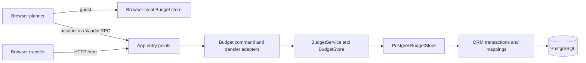

# Step 2 — Architecture and module boundaries

Observation date: **7 November 2026 (Europe/Moscow)**.

**Assessment:** the reviewed MVP has a coherent modular-monolith structure.
The checked production sources preserve the important dependency and persistence
boundaries. Two follow-ups remain: the active planner loses save-result metadata
at its transport boundary, and the composition root relies on undeclared direct
infrastructure dependencies. Neither is evidence of a failed database commit or
a production incident.

## Scope and evidence

Use the [Step 1 frozen baseline](01-baseline.md): app
`f78682778eebed86730ec457f63c96648f19370d`, Budget
`43d86d28965a241cd45f7938c1adfb2ec50f8132`, and ORM
`8daaf91d07d2e30b563322b22a0c6da7545578e5`.

[PR #13](https://github.com/finance-lab-project/app/pull/13) was independently
confirmed merged at `20ff9a9feb1d286e110445714b6fdcc6a8b28a0f`.
Compared with the frozen app baseline, that commit adds only the review documents
and README link. The application source baseline therefore remains unchanged.

This step inspected production imports and qualified references, direct Maven
dependencies, startup/wiring, entry points, business-service and persistence
ports, mapping ownership, transaction callbacks and planner/transfer adapters.
It compared those boundaries with the
[canonical dependency rules](https://github.com/finance-lab-project/app/blob/f78682778eebed86730ec457f63c96648f19370d/docs/architecture.md#L519-L556),
[ORM contract](https://github.com/finance-lab-project/app/blob/f78682778eebed86730ec457f63c96648f19370d/docs/architecture.md#L750-L811) and
[Budget persistence contract](https://github.com/finance-lab-project/budget/blob/43d86d28965a241cd45f7938c1adfb2ec50f8132/docs/persistence.md#L8-L31).

Local source snapshots were checked against all 83 corresponding Git blob
hashes. The production dependency inventory covers **60 Java files: app 13,
Budget 18, ORM 29**. Runtime spikes, verification applications and all test
sources are excluded from that count. Selected scripts, descriptors and
documentation supplement the Java inventory.

## Actual responsibilities

| Boundary | Implemented owner and responsibility | Evidence |
| --- | --- | --- |
| Composition and resource lifecycle | App constructs the pool, ORM runner and concrete Budget adapter, verifies mappings, and closes the pool on failed initialization or shutdown. | [ApplicationLifecycle](https://github.com/finance-lab-project/app/blob/f78682778eebed86730ec457f63c96648f19370d/application/src/main/java/org/financelab/app/ApplicationLifecycle.java#L32-L68) |
| Identity and transport | Jetty's separate authentication adapter establishes the owner principal. App filters/routes protect entry points and supply a server-derived identity. BudgetService checks that identity on every operation. | [ConfiguredLoginService](https://github.com/finance-lab-project/app/blob/f78682778eebed86730ec457f63c96648f19370d/authentication/src/main/java/org/financelab/auth/ConfiguredLoginService.java#L25-L56), [OwnerIdentity](https://github.com/finance-lab-project/app/blob/f78682778eebed86730ec457f63c96648f19370d/application/src/main/java/org/financelab/app/OwnerIdentity.java#L12-L22), [BudgetService](https://github.com/finance-lab-project/budget/blob/43d86d28965a241cd45f7938c1adfb2ec50f8132/src/main/java/org/financelab/budget/application/BudgetService.java#L18-L45) |
| Budget domain | Monthly snapshots, amounts, categories and their invariants use Java/domain types. Domain sources have no UI, JDBC or ORM imports. | [domain sources](https://github.com/finance-lab-project/budget/tree/43d86d28965a241cd45f7938c1adfb2ec50f8132/src/main/java/org/financelab/budget/domain) |
| Budget application boundary | BudgetService supplies authenticated operations. BudgetStore defines coarse-grained saves and materialized domain/revision views; SaveResult represents business-facing outcomes. | [BudgetStore](https://github.com/finance-lab-project/budget/blob/43d86d28965a241cd45f7938c1adfb2ec50f8132/src/main/java/org/financelab/budget/application/BudgetStore.java#L15-L46), [SaveResult](https://github.com/finance-lab-project/budget/blob/43d86d28965a241cd45f7938c1adfb2ec50f8132/src/main/java/org/financelab/budget/application/SaveResult.java) |
| Budget persistence | PostgresBudgetStore owns owner-scoped queries, aggregate reconstruction, locks, revision selection and write sets. BudgetMappings owns the module's explicit storage descriptors. | [PostgresBudgetStore](https://github.com/finance-lab-project/budget/blob/43d86d28965a241cd45f7938c1adfb2ec50f8132/src/main/java/org/financelab/budget/adapter/postgres/PostgresBudgetStore.java#L29-L60), [BudgetMappings](https://github.com/finance-lab-project/budget/blob/43d86d28965a241cd45f7938c1adfb2ec50f8132/src/main/java/org/financelab/budget/adapter/postgres/BudgetMappings.java) |
| ORM mechanics | ORM executes generic mapping operations and callback-scoped JDBC transactions. It imports no app, Budget, Portfolio or FIRE code. | [Transactions](https://github.com/finance-lab-project/orm/blob/8daaf91d07d2e30b563322b22a0c6da7545578e5/src/main/java/org/financelab/orm/Transactions.java), [JdbcTransactions](https://github.com/finance-lab-project/orm/blob/8daaf91d07d2e30b563322b22a0c6da7545578e5/src/main/java/org/financelab/orm/JdbcTransactions.java#L47-L139) |
| Schema changes | Budget owns migration resources. App supplies a separate administrative Flyway command; normal startup verifies mappings rather than migrating the schema. | [BudgetMigration](https://github.com/finance-lab-project/app/blob/f78682778eebed86730ec457f63c96648f19370d/application/src/main/java/org/financelab/app/BudgetMigration.java), [startup verification](https://github.com/finance-lab-project/app/blob/f78682778eebed86730ec457f63c96648f19370d/application/src/main/java/org/financelab/app/ApplicationLifecycle.java#L38-L46) |

The parent POM supplies build conventions. Budget and ORM have no dependency on
the application WAR. The production reference graph contains only
`app -> Budget`, `app -> ORM`, and `Budget -> ORM`; there is no reverse product
dependency or product-module cycle in the inspected source references.

The conceptual `api/` package in the architecture is currently represented by
public application services/records. Those records contain domain values and
revision metadata, with no JDBC connections, ORM sessions or persistence
exceptions. A separate API artifact or additional package is not needed to
establish the inspected boundary.

## Planner and transfer paths

The arrows below describe runtime calls/data flow, not Maven dependency declarations.

The guest page is app-owned HTML hosting Budget's planner markup and scripts.
The account route is a Vaadin view hosting the **same markup and planner script**;
its `@ClientCallable` method forwards JSON commands to Budget's adapter and
authenticated service. Transfer uses an app servlet for request protection and
Budget's adapter for mapping/import decisions. This is a Vaadin/servlet
application with substantial browser-side presentation logic.

Sources: [guest host](https://github.com/finance-lab-project/app/blob/f78682778eebed86730ec457f63c96648f19370d/application/src/main/java/org/financelab/app/AppPages.java#L81-L85),
[account host and RPC](https://github.com/finance-lab-project/app/blob/f78682778eebed86730ec457f63c96648f19370d/application/src/main/java/org/financelab/app/BootstrapView.java#L22-L50),
[shared planner](https://github.com/finance-lab-project/budget/blob/43d86d28965a241cd45f7938c1adfb2ec50f8132/src/main/java/org/financelab/budget/adapter/ui/BudgetPlanner.java#L41-L76),
[transfer host](https://github.com/finance-lab-project/app/blob/f78682778eebed86730ec457f63c96648f19370d/application/src/main/java/org/financelab/app/TransferServlet.java#L17-L44),
[browser-local store](https://github.com/finance-lab-project/budget/blob/43d86d28965a241cd45f7938c1adfb2ec50f8132/src/main/resources/META-INF/resources/ui/store.js#L86-L123).

The library also retains the component-based BudgetWorkspace/MonthEditor/
CategoryEditor implementation. The frozen production app uses the shared
BudgetPlanner path, not BudgetWorkspace. Their behavior must not be assumed
identical: the save-result handling differs as described in S2-01.
[Component implementation](https://github.com/finance-lab-project/budget/blob/43d86d28965a241cd45f7938c1adfb2ec50f8132/src/main/java/org/financelab/budget/adapter/ui/BudgetWorkspace.java#L166-L192)

Guest data has independent browser storage, but anonymous pages share the WAR's
deployment availability: startup still requires valid app/account configuration,
a database pool and mapping verification. The canonical architecture already
states that a shared process does not provide fault isolation. This is an
operating boundary, not an additional release defect.
[System boundary](https://github.com/finance-lab-project/app/blob/f78682778eebed86730ec457f63c96648f19370d/docs/architecture.md#L75-L82)

## Transaction ownership

| Operation | Boundary observed in source |
| --- | --- |
| Monthly Save | One BudgetStore save enters one ORM write callback for its locked reads, facts, guard and revision. |
| Catalog Save / initialization | Each has its own ORM write callback. |
| Current state / historical detail | Each BudgetStore read enters one read-only snapshot callback and returns materialized values. |
| Guest history transfer | Each replayed revision is a separate service save and transaction; the final current snapshot is another save. |
| Category transfer and multiple selected months | Separate requests/operations; previously committed parts can remain when a later part stops. |
| Browser-local cleanup after transfer | Follows a confirmed server reply and is outside the PostgreSQL transaction. |

The application port defines the semantic operation boundary; the PostgreSQL
adapter implements it with ORM transactions. This matches the module's explicit
persistence contract. SQL and JDBC scope stay below the UI/application port.
Budget's only production references to ORM are BudgetMappings and
PostgresBudgetStore.

The ORM runner configures READ COMMITTED writes and read-only REPEATABLE READ
snapshots, prevents nested scopes, invalidates sessions after callbacks, and
commits before returning the write result. UI editing spans no database
transaction. These are source observations; Step 4 must verify database and
failure behavior through execution.

Sources: [Budget write/read wrappers](https://github.com/finance-lab-project/budget/blob/43d86d28965a241cd45f7938c1adfb2ec50f8132/src/main/java/org/financelab/budget/adapter/postgres/PostgresBudgetStore.java#L347-L365),
[monthly write set](https://github.com/finance-lab-project/budget/blob/43d86d28965a241cd45f7938c1adfb2ec50f8132/src/main/java/org/financelab/budget/adapter/postgres/PostgresBudgetStore.java#L103-L147),
[ORM scope/commit](https://github.com/finance-lab-project/orm/blob/8daaf91d07d2e30b563322b22a0c6da7545578e5/src/main/java/org/financelab/orm/JdbcTransactions.java#L55-L139),
[session confinement](https://github.com/finance-lab-project/orm/blob/8daaf91d07d2e30b563322b22a0c6da7545578e5/src/main/java/org/financelab/orm/JdbcTransactions.java#L164-L182),
[transfer replay](https://github.com/finance-lab-project/budget/blob/43d86d28965a241cd45f7938c1adfb2ec50f8132/src/main/java/org/financelab/budget/adapter/ui/PlannerTransfer.java#L157-L185),
[local acknowledgement](https://github.com/finance-lab-project/budget/blob/43d86d28965a241cd45f7938c1adfb2ec50f8132/src/main/resources/META-INF/resources/ui/transfer.js#L78-L109).

## Findings

### S2-01 — Medium: the shared planner drops confirmed-save revision metadata

**Observed:** BudgetService returns Saved/Unchanged with a revision, but
PlannerCommands converts both to `{saved:true}`. The active JavaScript planner
then reads the month/catalog again and returns success only if that refresh
succeeds. If the refresh fails, `load()` blocks further writes and `save()`
returns false even though the preceding save reply confirmed success. Navigation
that waits for save completion consequently stays on the editor.

This differs from the documented acknowledgement-without-an-additional-read
contract. BudgetWorkspace already consumes the returned revision directly, so
checking only that implementation would miss the active planner's different
contract. Source evidence:
[result reduction](https://github.com/finance-lab-project/budget/blob/43d86d28965a241cd45f7938c1adfb2ec50f8132/src/main/java/org/financelab/budget/adapter/ui/PlannerCommands.java#L85-L88),
[save then refresh](https://github.com/finance-lab-project/budget/blob/43d86d28965a241cd45f7938c1adfb2ec50f8132/src/main/resources/META-INF/resources/ui/local.js#L165-L195),
[read-failure handling](https://github.com/finance-lab-project/budget/blob/43d86d28965a241cd45f7938c1adfb2ec50f8132/src/main/resources/META-INF/resources/ui/local.js#L49-L57),
[documented contract](https://github.com/finance-lab-project/budget/blob/43d86d28965a241cd45f7938c1adfb2ec50f8132/docs/ui.md#L56-L64).

**Impact and limit:** a UI refresh failure can obscure a confirmed save and
force a manual reload. The failure path preserves the draft and blocks retries;
this finding does not establish lost data or an incorrectly committed value.
The consequence is derived from source control flow; no fault-injection browser
journey was executed in Step 2.

**Smallest follow-up:** carry the accepted revision and outcome through the
planner adapter, update the editor's accepted state from that reply, and keep
refresh feedback distinct from save acknowledgement. Step 3 should exercise a
confirmed save followed by a failed read on the active shared-planner path.

### S2-02 — Low: composition dependencies are obtained transitively

**Observed:** ApplicationLifecycle directly uses ORM and Hikari classes, while
the application POM declares Budget but not ORM or Hikari as direct dependencies.
Budget declares ORM; ORM declares Hikari. Thus the root's direct infrastructure
usage is represented only indirectly in its build contract.
[Root imports/wiring](https://github.com/finance-lab-project/app/blob/f78682778eebed86730ec457f63c96648f19370d/application/src/main/java/org/financelab/app/ApplicationLifecycle.java#L3-L12),
[application dependencies](https://github.com/finance-lab-project/app/blob/f78682778eebed86730ec457f63c96648f19370d/application/pom.xml#L16-L31),
[Budget dependency](https://github.com/finance-lab-project/budget/blob/43d86d28965a241cd45f7938c1adfb2ec50f8132/pom.xml#L19-L23),
[ORM dependencies](https://github.com/finance-lab-project/orm/blob/8daaf91d07d2e30b563322b22a0c6da7545578e5/pom.xml#L15-L18).

**Impact and limit:** the POM understates what the root owns and directly needs
to compile. Removing or rescoping an indirect dependency can break the root's
composition code. This is a dependency-declaration risk, not an observed failure
of the frozen build. Maven's
[dependency guidance](https://maven.apache.org/guides/introduction/introduction-to-dependency-mechanism.html#transitive-dependencies)
recommends declaring dependencies used directly by source.

**Smallest follow-up:** declare the root's direct ORM/Hikari dependencies using
the already selected compatible versions, then check dependency resolution in
Step 6. Direct Jackson usage in the app/Budget transport adapters should also
be included in that dependency-declaration check; its resolved transitive path
was not established in this step.

## Transfer observation to carry into Step 3

PlannerTransfer combines form/JSON adaptation with catalog matching, blank-field
preservation and revision-replay orchestration. Those policies belong to Budget,
so the app itself remains a thin transport host, but the workflow currently
lives in a UI adapter and commits incrementally.
[Catalog policy](https://github.com/finance-lab-project/budget/blob/43d86d28965a241cd45f7938c1adfb2ec50f8132/src/main/java/org/financelab/budget/adapter/ui/PlannerTransfer.java#L30-L71),
[merge/replay policy](https://github.com/finance-lab-project/budget/blob/43d86d28965a241cd45f7938c1adfb2ec50f8132/src/main/java/org/financelab/budget/adapter/ui/PlannerTransfer.java#L88-L185).

Record this as **O2-01, a contract clarification rather than a confirmed defect**:
a stopped transfer can leave earlier revisions/categories/months in the account
while retaining the browser originals. Step 3 should check the user-visible
stop/resume behavior after a middle replay failure, an unknown commit outcome,
or a browser-local acknowledgement failure. Preserve short transaction scopes
and make partial progress explicit. Whether a typed application-level import
operation is useful should follow that workflow review, not an assumed need for
a broader abstraction.

## Verification and limits

- Confirmed PR #13's merge and compared app source-tree entries with Step 1.
- Verified all 83 local snapshot files against their Git blob hashes.
- Parsed production package/import/qualified-reference relationships across the
  four exact production source roots. The first inventory scope included
  verification fixtures; it was corrected before producing the production
  results. The final 60-file layer checks passed with zero prohibited references.
- Parsed direct dependencies from the application, authentication, Budget and
  ORM POMs. Traced the two active planner entry points, transfer path, migration
  entry point and store/transaction wrappers.
- Performed static inspection only. No runtime test suite, resolved dependency-tree
  build, security scan or benchmark was executed as part of the source analysis.
  Any subsequent documentation-PR CI run is separate evidence. Lexical dependency
  checks do not prove bytecode, reflective or runtime isolation.
- Deployment correspondence remains the open Step 1 evidence gap. These findings
  apply to the frozen sources, not to an independently identified production WAR.

No code, dependencies or architecture contracts are changed by this report.
