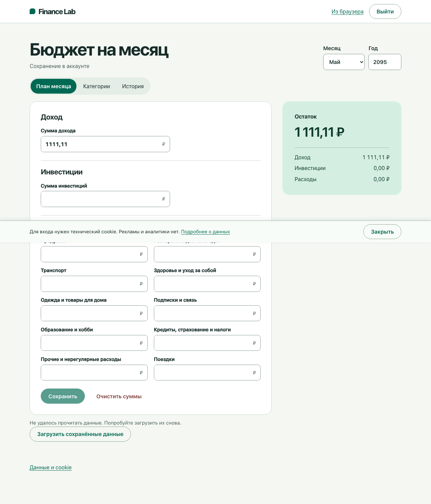

# Step 3 — Complete workflow correctness

Observation date: **7 November 2026 (Europe/Moscow)**.

**Result:** the checked core workflows passed, and the review reproduced **two
UI defects** plus a **history-transfer recovery limitation**. The defects remain
in the frozen source; this step records evidence and does not implement fixes.

## Baseline and execution environment

Use the [Step 1 baseline](01-baseline.md): app
`f78682778eebed86730ec457f63c96648f19370d`, Budget
`43d86d28965a241cd45f7938c1adfb2ec50f8132`, and ORM
`8daaf91d07d2e30b563322b22a0c6da7545578e5`.
[PR #14](https://github.com/finance-lab-project/app/pull/14) was independently
confirmed merged at `ee4655bb14d8bec3bb0c5db0a6913dcdf3997786`.
It changes review documentation, not the application under test.

Checks ran locally on macOS arm64 with Java 27.0.1.0.3, Maven 3.10.0,
Node 24.22.2/npm 11.19.1, Jetty 12.1.14/EE11, PostgreSQL 18.6,
and Playwright Java 1.64.0 with Chrome Headless Shell 156.0.8078.4.
The application and database ran in isolated test infrastructure with a synthetic
account. Browser contexts used an English locale and Pacific/Honolulu time zone
while the application retained Russian/Moscow presentation.

The additional review class was compiled into ignored test output **after WAR
packaging**. It was not added to the WAR and required no production test route.
The resulting five-file SHA-256 manifest exactly matches the earlier CI
manifest in Step 1, including WAR
`a2a81f71a567587934cf7c830b3adf2b4c10d4fa1e9004f9fc60fbfdba27307a`.
The packaged planner script also byte-matched the frozen Budget source.
App, Budget and ORM working trees remained clean.

This identifies the locally tested candidate. The public deployment's identity
remains unverified because no deployment manifest is available.

## Executed checks

| Check | Observed result |
| --- | --- |
| Budget domain/service/presentation tests | 119 passed |
| Budget real-PostgreSQL integration tests | 29 passed |
| App/authentication unit tests | 7 passed in each of two clean builds |
| Packaged WAR smoke test | 1 passed |
| Existing integrated planner journeys | 2 passed |
| Additional review cases | 8 passed: 5 browser cases and 3 transfer/persistence-port cases |
| Existing authentication phases | Default, rotated credentials, idle expiry and absolute expiry each passed |
| Original verifier completion | Two byte-identical clean output builds, startup checks and bounded shutdown passed |

**Interpretation:** the review class mixes assurance checks and
issue-characterization checks. A passing characterization case means that the
documented defective or limited behavior was reproduced; it does not mean the
product has been fixed.

The versioned [review harness](reproductions/step-3/README.md) contains the exact
case source and runner. [results.json](evidence/step-3/results.json) records
sanitized suite counts, case names, replay outcomes, close events, source
revisions and artifact/reproduction digests.

## Workflow coverage

| Workflow | Evidence and outcome |
| --- | --- |
| Money input and presentation | Existing Java tests plus the active guest planner checked decimal precision, exact maximum input, rejection above the maximum, rejection of negative entered amounts, zero versus unset, and negative derived balance. Invalid saves did not append local history. |
| Explicit Save, reload and history | Existing journeys checked local reload, account saves and a second authenticated browser. The additional guest case checked no-op history and read-only unset/zero presentation. |
| Dirty navigation | Save/Discard/Stay worked when the previous prompt had completed. Rapid dialog reuse exposed S3-02. |
| Category lifecycle and historical labels | Existing integrated journey checked add/rename/archive, preservation of archived monthly values, transfer and original historical labels. The session-conflict case also checked that a later catalog rename did not rewrite the saved month's history. |
| Stale monthly and catalog saves | Two authenticated contexts loaded the same month. A competing month save and a subsequent catalog rename each rejected the stale draft, kept its input, disabled writes, and required explicit reload. Neither stale attempt added history. |
| Guest-to-account transfer | Existing journeys checked a second browser, blank-field preservation, review of conflicting cloud amounts and renewed review when cloud state changed. |
| Confirmed save followed by failed refresh | Genuine account commit plus a forced read rejection reproduced S3-01; another browser saw exactly one committed revision. |
| Interrupted history replay | Three controlled outcomes around the second save established the committed prefix and explicit-retry behavior in S3-03. |
| Local acknowledgement failure | Rejecting local deletion after a successful server response kept the browser copy. Restoring storage and retrying removed the copy without duplicating the account revision. |

## S3-01 — Medium: a failed refresh obscures a confirmed save

This is the runtime confirmation of [S2-01](02-architecture.md#s2-01--medium-the-shared-planner-drops-confirmed-save-revision-metadata).

The review used a normal authenticated account Save. After the real RPC returned
`saved:true`, a browser-side bridge wrapper rejected the next month-read
operation. The editor displayed a read-failure message, disabled Save, retained
the typed `1111,11` and stayed on the month panel after Save-and-navigate.
A second authenticated browser read **1 111,11 RUB and one committed revision**.
The bridge recorded one confirmed write and one rejected read.

The save was durable; completing the UI save/navigation flow still depended on
a separate read. There was no automatic retry or observed loss of the saved data.

Source chain:
[reply drops revision metadata](https://github.com/finance-lab-project/budget/blob/43d86d28965a241cd45f7938c1adfb2ec50f8132/src/main/java/org/financelab/budget/adapter/ui/PlannerCommands.java#L85-L88),
[save awaits refresh](https://github.com/finance-lab-project/budget/blob/43d86d28965a241cd45f7938c1adfb2ec50f8132/src/main/resources/META-INF/resources/ui/local.js#L165-L195),
[read failure blocks writes](https://github.com/finance-lab-project/budget/blob/43d86d28965a241cd45f7938c1adfb2ec50f8132/src/main/resources/META-INF/resources/ui/local.js#L49-L57).

**Follow-up:** preserve the confirmed outcome/revision through the adapter and
acknowledge the accepted edit independently of subsequent refresh feedback.
Add a regression expectation for successful acknowledgement when that refresh
fails.

## S3-02 — Medium: rapid dialog reuse can ignore the next Discard decision

The initial browser interaction exposed this sequence: change a dirty month,
choose Stay, select the next month again, then choose Discard. Both pending
navigation listeners consumed the earlier close event with value `stay`.
The later `discard` close event had no listener left, so the editor did not
change months.

A controlled comparison established both cases:

- Waiting for the previous close event allowed normal navigation to finish.
- Scheduling cancel/reopen before that event arrived reproduced the failure
  deterministically. The first close event arrived with `value=stay, open=true`
  while the second prompt was open. The second event had
  `value=discard, open=false`, but no navigation followed.

In the controlled case January 2096 stayed selected, the unsaved income remained
130, and the stored January value stayed 100. The test observed no unintended
write or lost draft.

The shared dialog uses a new once-only close listener for every `canLeave()`
call, but the busy guard covers data operations rather than an outstanding
dialog decision.
[Dialog decision and month navigation](https://github.com/finance-lab-project/budget/blob/43d86d28965a241cd45f7938c1adfb2ec50f8132/src/main/resources/META-INF/resources/ui/local.js#L190-L215)

**Follow-up:** serialize pending navigation decisions and keep each dialog's
answer tied to its own interaction. Prevent a new request from reusing the
dialog while an earlier close result is still pending. Cover rapid cancel,
reselect and discard on the active shared planner.

## S3-03 — Recovery limitation: retry does not resume an interrupted history replay

This resolves [O2-01](02-architecture.md#transfer-observation-to-carry-into-step-3)
with runtime evidence. The synthetic source history was income **100, 200, 300**.
The review interrupted the second save using a BudgetStore decorator around the
real PostgreSQL adapter.

| Injected outcome for the second save | Stored account prefix after interruption | Account history after explicit preview/confirmation and retry |
| --- | --- | --- |
| Failed before delegation | 100 | 100, 300 |
| Unknown before delegation | 100 | 100, 300 |
| Commit through the real adapter, then return Unknown | 100, 200 | 100, 200, 300 |

Each interruption returned 409. Preview performed no automatic write retry.
The final user-confirmed operation saved the latest value 300 and returned
`copiedHistory=false`. The source form/history payload remained unchanged.

The reason is explicit in the implementation: earlier versions are replayed
only while the account month has version zero. Once a prefix exists, retry uses
the existing-month merge path. The browser transfer code retains originals when
the source has multiple versions, including when the latest snapshot is later
marked transferred.

Sources:
[history accepted only for a new month](https://github.com/finance-lab-project/budget/blob/43d86d28965a241cd45f7938c1adfb2ec50f8132/src/main/java/org/financelab/budget/adapter/ui/PlannerTransfer.java#L114-L121),
[one transaction per replay and final snapshot](https://github.com/finance-lab-project/budget/blob/43d86d28965a241cd45f7938c1adfb2ec50f8132/src/main/java/org/financelab/budget/adapter/ui/PlannerTransfer.java#L157-L185),
[retention of browser originals](https://github.com/finance-lab-project/budget/blob/43d86d28965a241cd45f7938c1adfb2ec50f8132/src/main/resources/META-INF/resources/ui/transfer.js#L78-L109).

This is **not evidence that the latest amount is lost**, and the current design
does not promise an atomic multi-month transfer. It is a recovery limitation:
retry can complete the latest-value transfer without reconstructing a missing
middle account revision. The preserved browser original remains important.

**Follow-up:** document this latest-only retry outcome and keep originals.
Decide whether resumable full-history transfer is required for a later release;
if selected, define its operation/reconciliation contract before implementation.
A single large transaction for all selected months is not required by this
review.

## Methods, corrections and limits

- Budget's unchanged verifier supplied the 119 unit and 29 PostgreSQL checks.
  Its already tested JAR was installed with tests skipped for app assembly.
- Dependency resolution used an isolated local Maven repository with read access
  to cached release artifacts and normal remote fallback. Empty-cache dependency
  availability was not established here; that belongs to Step 6.
- The review runner reused the frozen app verifier and inserted only compilation
  and execution of the additional test class after the standard planner journeys.
  Final execution completed all original verifier phases.
- The first local-storage acknowledgement case was corrected to honor the
  account's category-confirmation prompt. The original month-navigation failure
  was traced and retained as S3-02 rather than hidden by a delay.
- Browser waits were made compatible with the app's existing CSP. No bypass or
  weakening of that policy was introduced.
- The refresh failure was injected at the browser planner callback after a
  genuine save. Replay outcomes were injected at the BudgetStore result boundary.
  These cases do not test PostgreSQL network-disconnect classification; that
  belongs to Step 4.
- These are local Chromium results against disposable synthetic data. Other
  browser engines, production deployment/recovery, sustained load and a full
  security assessment were not established by this step.
